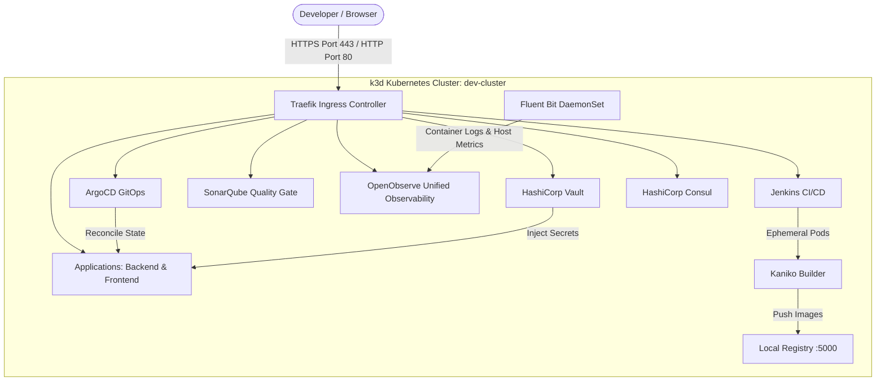

# Features and Roadmap: Local Kubernetes DevOps Laboratory

This document outlines the architectural features, current capabilities, and strategic roadmap for the `ed-devops` local Kubernetes platform.

---

## 1. Executive Summary & Architecture Vision

`ed-devops` is an enterprise-grade, rootless-compatible local DevOps and GitOps platform. It simulates real-world production engineering environments on a local workstation using lightweight, open-source technologies:
- **Zero-Warning Local TLS** (`mkcert`) on **Standard Ports (`80` / `443`)**
- **Rootless Podman + k3d (k3s)** with cgroup v2 delegation
- **In-Cluster CI/CD Engine** (Jenkins with dynamic Kubernetes agent pods & Kaniko rootless image builds)
- **GitOps Continuous Delivery** (ArgoCD with automated drift reconciliation)
- **Code Quality & Security Governance** (SonarQube with strict 80% coverage quality gates)
- **Enterprise Secret & Config Management** (HashiCorp Vault with Kubernetes Auth & Consul KV)
- **Autonomous Resource Maintenance** (Scheduled build discarding, image pruning, and volume cleanup)
- **Unified Observability & Telemetry** (OpenObserve standalone engine + Fluent Bit DaemonSet log & metric shipper)

---

## 2. Platform Capability Matrix

| Capability | Current State | Target Future State | Status |
| :--- | :--- | :--- | :--- |
| **Container Engine** | Rootless Podman 4/5 + k3d | Rootless Podman + k3d | ✅ Implemented |
| **Ingress & Networking** | Traefik Ingress (Ports 80/443), mkcert TLS | Gateway API / Traefik Ingress | ✅ Implemented |
| **CI Engine** | Jenkins JCasC + Ephemeral Agent Pods | Jenkins + Shared Library | ✅ Implemented |
| **Build Optimization** | Remote Kaniko Caching, Gradle & Flutter PVC Caches | Distributed Caching | ✅ Implemented |
| **Code Quality** | SonarQube + 80% coverage Quality Gate | SonarQube + Automated Rule Enforcement | ✅ Implemented |
| **GitOps CD** | ArgoCD Raw Manifests | ArgoCD + Kustomize Overlays + Image Updater | ⚪ Planned |
| **Secret Management** | Vault KV-v2 + K8s Auth Injector | Vault Auto-rotation & Dynamic DB Credentials | ✅ Implemented |
| **Observability** | OpenObserve + Fluent Bit (Cluster Logs & Metrics) | Spring Boot Micrometer Dashboards & Alert Rules | ✅ Implemented |
| **Storage Lifecycle** | Autonomous Build & Image Cleanup CronJob | Autonomous Cleanup + Metrics Alerting | ✅ Implemented |
| **Developer Experience** | Healthcheck (`make healthcheck`), Lint (`make lint`), Worktrees (`make worktree`) | One-click local disaster recovery drill | ✅ Implemented |

---

## 3. Strategic Improvement Roadmap

### Milestone 1: CI/CD Build Optimization & Performance
**Objective**: Drastically reduce build times, preserve network bandwidth, and provide rich test analytics.
**Status**: ✅ **Completed**

1. **Kaniko Remote Layer Caching** (✅ Completed):
   - Enabled `--cache=true` and `--cache-repo=k3d-dev-registry:5000/kaniko-cache` in Jenkins pipelines with `ENABLE_CACHE` toggle.
   - Cache intermediate Dockerfile layers directly inside the local registry.
   - Accelerates container build times by 5x to 10x for recurring commits.
2. **Persistent Volume Caching for Frontend & Backend** (✅ Completed):
   - Provisioned persistent storage for Flutter packages (`/root/.pub-cache` via `jenkins-flutter-cache-pvc`).
   - Persistent volume storage configured for Gradle caches (`jenkins-gradle-cache-pvc`).
   - Eliminates re-downloading Flutter and Gradle dependencies across clean builds.
3. **JUnit Test Report Analytics** (✅ Completed):
   - Integrated `junit testResults: '**/build/test-results/test/*.xml'` into backend deployment pipeline.
   - Exposes test execution trends, pass/fail ratios, and failure stack traces directly on the Jenkins dashboard.
4. **Credential Decoupling** (✅ Completed):
   - Automated registration of SonarQube tokens into Jenkins Credentials store (`sonar-token`) via `setup-sonarqube-rules.sh`.
   - Pipelines bind credentials dynamically via `withCredentials([string(credentialsId: 'sonar-token', variable: 'SONAR_TOKEN')])`.

---

### Milestone 2: Developer Experience (DX) & Quality Assurance
**Objective**: Enhance developer workflow velocity and provide automated verification.
**Status**: ✅ **Completed**

1. **Unified Health Check (`make healthcheck`)** (✅ Completed):
   - Automated script `scripts/healthcheck.sh` that validates:
     - Kubernetes cluster and node readiness
     - Ingress routes and TLS certificates (`*.localhost`)
     - System APIs: SonarQube (`UP`), Vault (unsealed), Consul (leader elected), OpenObserve (`ok`), Jenkins (HTTP 200), ArgoCD (HTTP 200)
     - Application Ingress & Spring Boot Actuator status
     - PostgreSQL database ping and user connections
     - Pod health & abnormal restart detection across all namespaces
2. **Automated Worktree Helper (`make worktree BRANCH=<name>`)** (✅ Completed):
   - Automated helper `scripts/worktree-helper.sh` ensuring `origin/main` is fetched before branching into isolated worktrees.
3. **Static Analysis & Linting (`make lint`)** (✅ Completed):
   - Automated script `scripts/lint.sh` validating:
     - Shell script syntax across all `scripts/*.sh` (`bash -n`)
     - Helm chart validation (`helm lint helm/postgres`)
     - YAML validation across all Helm values and Kubernetes manifests
     - Kubernetes manifest dry-run validation (`kubectl apply --dry-run=client -R -f manifests/`)

---

### Milestone 3: Observability & Telemetry Stack
**Objective**: Full visibility into cluster resource consumption, application performance, and access logs.
**Status**: ✅ **Implemented**

1. **Unified Log & Metric Engine (OpenObserve + Fluent Bit)** (✅ Completed):
   - Deployed single-binary OpenObserve (`openobserve.localhost`) with persistent storage on k3s local-path and zero-warning TLS.
   - Deployed Fluent Bit DaemonSet collecting stdout/stderr container logs from all pods across all namespaces (`k8s_logs`).
   - Node and host telemetry collected via `node_exporter_metrics`.
   - Integrated OpenObserve UI into local wildcard TLS ingress (`https://openobserve.localhost`).
2. **Spring Boot Application Telemetry (`ilmiya-backend`)** (✅ Completed):
   - Scrapes Actuator Micrometer metrics (`/actuator/prometheus`) directly into OpenObserve via Fluent Bit.
   - Monitors JVM Heap usage, Garbage Collection pauses, thread pool saturation, and HikariCP connection pool metrics.
   - Tracks HTTP request latency percentiles (p50, p95, p99) and response code distributions (2xx, 4xx, 5xx).
3. **Dashboards & Visualizations** (✅ Completed):
   - Automated provisioning script (`scripts/setup-openobserve-dashboards.sh`) to seed production-grade dashboards.
4. **Frontend Telemetry & Web Vitals (`ilmiya-frontend`)** (⚪ Planned):
   - Stream Nginx access logs with structured request attributes (client IP, latency, HTTP method, user agent).
5. **Advanced Alert Thresholds & RCA** (⚪ Planned):
   - Configure alert rules (e.g. JVM memory > 85%, HTTP 5xx error spikes, or container CrashLoopBackOff events).

---

### Milestone 4: GitOps Standardization & Manifest Architecture
**Objective**: Eliminate imperative rollouts and achieve fully automated GitOps synchronization.

1. **Kustomize / Helm App Manifests**:
   - Refactor `manifests/apps/ilmiya-backend` and `manifests/apps/ilmiya-frontend` from static manifests to structured Kustomize bases and overlays.
   - Standardize resource limits, environment variables, and ingress rules across microservices.
2. **ArgoCD Image Updater**:
   - Deploy ArgoCD Image Updater to continuously track new tags pushed to `k3d-dev-registry:5000`.
   - Automatically reconcile deployments in Kubernetes without manual `kubectl rollout restart` triggers.

---

### Milestone 5: Database Resilience & Disaster Recovery
**Objective**: Guarantee state persistence, safety, and smooth schema evolution.

1. **Automated PostgreSQL Backup & Retention**:
   - Implement scheduled `pg_dump` backups with gzip compression.
   - Support automated restore verification drills.
2. **Database Migration Pre-Flight Checks**:
   - Add automated Flyway/Liquibase schema validation in CI pipelines before triggering application rollouts.
