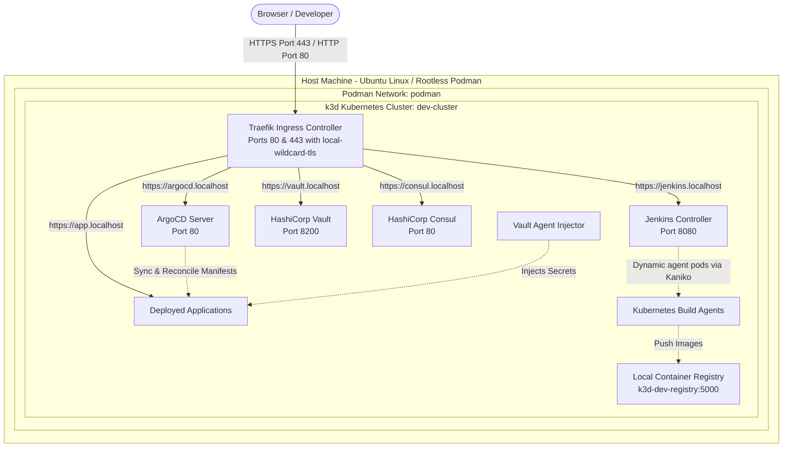

# Complete Step-by-Step Setup Guide: Local Kubernetes DevOps Laboratory

This guide explains in detail how the entire local DevOps platform is architected and built from scratch using **k3d**, **Rootless Podman**, **Jenkins**, **ArgoCD**, **HashiCorp Vault**, **HashiCorp Consul**, **mkcert Local TLS**, and **Traefik Ingress**.

---

## 1. Architectural Overview



### Key Architectural Decisions
1. **Clean URLs on Standard Ports**: All traffic runs on standard port `80` (HTTP) and `443` (HTTPS). No explicit ports like `:8080` in the browser.
2. **Zero-Warning Local TLS (`mkcert`)**: Root CA installed in system and browser NSS trust stores, generating valid certificates with explicit SANs for `*.localhost`.
3. **Decoupled Platform Architecture**: The platform provides foundational infrastructure (Kubernetes, Ingress, CI/CD, Secrets, Service Mesh) while individual application repositories manage their own builds and deployments.
4. **Rootless Podman Compatibility**: 100% daemonless, rootless container execution with cgroup v2 delegation and unprivileged port access.
5. **In-Cluster Dynamic Builds**: Jenkins uses ephemeral Kubernetes Pods running **Kaniko** to compile and push images without needing Docker-in-Docker or root permissions.

---

## 2. Host Prerequisites & Rootless Configuration

### Step 2.1: Enable Cgroup v2 `cpuset` Delegation
By default, Ubuntu user sessions only delegate `cpu memory pids`. Kubelet requires the `cpuset` controller to manage CPU core allocations.

```bash
sudo mkdir -p /etc/systemd/system/user@.service.d
sudo tee /etc/systemd/system/user@.service.d/delegate.conf << 'EOF'
[Service]
Delegate=cpu cpuset io memory pids
EOF

sudo systemctl daemon-reload
systemctl --user daemon-reexec
```
*Verification:*
```bash
cat /sys/fs/cgroup/user.slice/user-$(id -u).slice/cgroup.controllers
# Output must include: cpuset cpu io memory pids
```

### Step 2.2: Enable Unprivileged Port 80 & 443 Binding
Linux restricts ports below 1024 to root. To allow rootless Podman to bind ports `80` and `443`:

```bash
sudo tee /etc/sysctl.d/99-rootless.conf << 'EOF'
net.ipv4.ip_unprivileged_port_start=80
EOF

sudo sysctl --system
```
*Verification:*
```bash
cat /proc/sys/net/ipv4/ip_unprivileged_port_start
# Output must be: 80
```

### Step 2.3: Podman Docker-Compatible Socket
k3d interacts with container engines via the Docker REST API. Ensure the user socket is running:
```bash
systemctl --user enable --now podman.socket
```

Set environment variables in `~/.bashrc`:
```bash
export DOCKER_HOST="unix://$XDG_RUNTIME_DIR/podman/podman.sock"
export DOCKER_SOCK="$XDG_RUNTIME_DIR/podman/podman.sock"
```

---

## 3. Tooling Installation

Install all required command-line tools into `~/bin/` (or `/usr/local/bin/`):

### Step 3.1: Install `kubectl`, `helm`, and `k3d`
```bash
mkdir -p ~/bin

# 1. kubectl
KUBECTL_VERSION=$(curl -L -s https://dl.k8s.io/release/stable.txt)
curl -Lo ~/bin/kubectl "https://dl.k8s.io/release/${KUBECTL_VERSION}/bin/linux/amd64/kubectl"
chmod +x ~/bin/kubectl

# 2. helm
curl -fsSL https://raw.githubusercontent.com/helm/helm/main/scripts/get-helm-3 | USE_SUDO=false HELM_INSTALL_DIR=~/bin bash

# 3. k3d
curl -s https://raw.githubusercontent.com/k3d-io/k3d/main/install.sh | USE_SUDO=false K3D_INSTALL_DIR=~/bin bash
```

### Step 3.2: k3d Wrapper Script for Podman
To ensure every invocation of `k3d` automatically targets Podman's rootless socket:
```bash
mv ~/bin/k3d ~/bin/k3d.bin
cat << 'EOF' > ~/bin/k3d
#!/usr/bin/env bash
export XDG_RUNTIME_DIR=${XDG_RUNTIME_DIR:-/run/user/$(id -u)}
export DOCKER_HOST=${DOCKER_HOST:-unix://$XDG_RUNTIME_DIR/podman/podman.sock}
export DOCKER_SOCK=${DOCKER_SOCK:-$XDG_RUNTIME_DIR/podman/podman.sock}
exec "$HOME/bin/k3d.bin" "$@"
EOF
chmod +x ~/bin/k3d
```

### Step 3.3: Install `mkcert` and Browser Trust Tooling
To prevent browser `net::ERR_CERT_AUTHORITY_INVALID` warnings, install `libnss3-tools` (`certutil`) so `mkcert` can inject its Root CA into Chrome/Firefox NSS databases:

```bash
sudo apt update && sudo apt install -y libnss3-tools

# Download mkcert binary
curl -Lo ~/bin/mkcert https://github.com/FiloSottile/mkcert/releases/download/v1.4.4/mkcert-v1.4.4-linux-amd64
chmod +x ~/bin/mkcert

# Install local root CA into system and browser trust stores
mkcert -install
```

> [!NOTE]
> Completely close and reopen your browser after running `mkcert -install` to reload the certificate database.

---

## 4. Local TLS Certificates Generation

Because browsers and OpenSSL enforce RFC 6125 §6.4.3 (rejecting wildcards on single-level domains like `*.localhost`), we issue certificates with **explicit Subject Alternative Names (SANs)**:

```bash
mkdir -p certs
mkcert -cert-file certs/local-cert.pem -key-file certs/local-key.pem \
  localhost \
  "*.localhost" \
  vault.localhost \
  consul.localhost \
  jenkins.localhost \
  argocd.localhost
```

---

## 5. Local Container Registry & Cluster Creation

### Step 5.1: Create Local Registry
```bash
k3d registry create --default-network podman dev-registry --port 0.0.0.0:5000
```
*Accessible from host:* `http://localhost:5000/v2/_catalog`  
*Accessible within cluster:* `k3d-dev-registry:5000`

### Step 5.2: Cluster Configuration (`k3d-config.yaml`)
```yaml
apiVersion: k3d.io/v1alpha5
kind: Simple
metadata:
  name: dev-cluster
servers: 1
agents: 0
kubeAPI:
  hostPort: "6443"
ports:
  - port: 80:80
    nodeFilters:
      - loadbalancer
  - port: 443:443
    nodeFilters:
      - loadbalancer
registries:
  use:
    - k3d-dev-registry:5000
options:
  k3s:
    extraArgs:
      - arg: "--kubelet-arg=feature-gates=KubeletInUserNamespace=true"
        nodeFilters:
          - server:0
```

### Step 5.3: Start Cluster
```bash
k3d cluster create --config k3d-config.yaml
```

### Step 5.4: Apply TLS Secret to Kubernetes
```bash
kubectl create secret tls local-wildcard-tls \
  --cert=certs/local-cert.pem \
  --key=certs/local-key.pem \
  --dry-run=client -o yaml | kubectl apply -f -
```

---

## 6. Deploying Platform Services via Helm

### Step 6.1: HashiCorp Vault
Add repository:
```bash
helm repo add hashicorp https://helm.releases.hashicorp.com
helm repo update
```

Configuration (`helm/vault/values.yaml`):
```yaml
global:
  enabled: true
server:
  dev:
    enabled: true
    devRootToken: "root"
ui:
  enabled: true
  serviceType: "ClusterIP"
injector:
  enabled: true
```

Deploy:
```bash
helm upgrade --install vault hashicorp/vault -f helm/vault/values.yaml
```

---

### Step 6.2: HashiCorp Consul
Configuration (`helm/consul/values.yaml`):
```yaml
global:
  name: consul
  installK8sNetworkingCRDs: false
server:
  replicas: 1
  bootstrapExpect: 1
ui:
  enabled: true
  service:
    enabled: true
    type: ClusterIP
client:
  enabled: false
connectInject:
  enabled: false
```
> [!IMPORTANT]
> `connectInject: enabled: false` and `installK8sNetworkingCRDs: false` prevent mutating webhook crashes from blocking subsequent pod creations across the cluster.

Deploy:
```bash
helm upgrade --install consul hashicorp/consul -f helm/consul/values.yaml
```

---

### Step 6.3: Jenkins CI/CD
Add repository:
```bash
helm repo add jenkins https://charts.jenkins.io
helm repo update
```

Configuration (`helm/jenkins/values.yaml`):
```yaml
controller:
  admin:
    username: "admin"
    password: "admin123"
  resources:
    requests:
      cpu: "200m"
      memory: "1024Mi"
    limits:
      cpu: "2000m"
      memory: "2048Mi"
  javaOpts: "-Xmx1536m -Xms512m"
  initContainerResources:
    requests:
      cpu: "200m"
      memory: "512Mi"
    limits:
      cpu: "2000m"
      memory: "2048Mi"
  initContainerEnv:
    - name: JAVA_OPTS
      value: "-Xmx1024m -Xms256m"
  installLatestPlugins: false
persistence:
  enabled: true
  size: "5Gi"
```

Deploy:
```bash
helm upgrade --install jenkins jenkins/jenkins -f helm/jenkins/values.yaml
```

---

### Step 6.4: ArgoCD GitOps Continuous Delivery
Add repository:
```bash
helm repo add argo https://argoproj.github.io/argo-helm
helm repo update
```

Configuration (`helm/argocd/values.yaml`):
```yaml
global:
  domain: argocd.localhost

configs:
  params:
    server.insecure: true
  secret:
    # Bcrypt hash for "admin123"
    argocdServerAdminPassword: "$2a$10$oVbzkaBWQJr7QoifYHbm3uckkM9UiZC511Ue8mDOeYhpO0x8/h/T2"

server:
  resources:
    requests:
      cpu: "50m"
      memory: "128Mi"
    limits:
      cpu: "500m"
      memory: "512Mi"

repoServer:
  resources:
    requests:
      cpu: "50m"
      memory: "128Mi"
    limits:
      cpu: "500m"
      memory: "512Mi"

controller:
  resources:
    requests:
      cpu: "100m"
      memory: "256Mi"
    limits:
      cpu: "500m"
      memory: "512Mi"

dex:
  enabled: false

notifications:
  enabled: false
```

Deploy:
```bash
helm upgrade --install argocd argo/argo-cd -f helm/argocd/values.yaml
```

---

### Step 6.5: Ingress for Platform Services
Defined in `manifests/ingress/local-ingress.yaml`:
```yaml
apiVersion: networking.k8s.io/v1
kind: Ingress
metadata:
  name: local-ingress
  namespace: default
spec:
  ingressClassName: traefik
  tls:
    - hosts:
        - vault.localhost
        - consul.localhost
        - jenkins.localhost
        - argocd.localhost
      secretName: local-wildcard-tls
  rules:
    - host: vault.localhost
      http:
        paths:
          - path: /
            pathType: Prefix
            backend:
              service:
                name: vault-ui
                port:
                  number: 8200
    - host: consul.localhost
      http:
        paths:
          - path: /
            pathType: Prefix
            backend:
              service:
                name: consul-ui
                port:
                  number: 80
    - host: jenkins.localhost
      http:
        paths:
          - path: /
            pathType: Prefix
            backend:
              service:
                name: jenkins
                port:
                  number: 8080
    - host: argocd.localhost
      http:
        paths:
          - path: /
            pathType: Prefix
            backend:
              service:
                name: argocd-server
                port:
                  number: 80
```
Apply:
```bash
kubectl apply -f manifests/ingress/local-ingress.yaml
```

---

### Step 6.6: Grant Deployer Permissions to Jenkins Agents
To allow Jenkins agent pods to create and update application workloads in the `default` namespace:

```bash
kubectl apply -f manifests/jenkins/jenkins-deployer-rbac.yaml
```

---

## 7. Connecting External Applications & Microservices

When deploying microservices to this lab:

1. **Building Images with Kaniko**:
   In your application pipeline, use the dynamic Kubernetes agent with `gcr.io/kaniko-project/executor:debug` to build and push to `k3d-dev-registry:5000/<your-image>:<tag>`.
2. **Reverse Proxy & Single Domain**:
   If deploying a Frontend SPA and Backend REST API together, route them in an Ingress under a single host (e.g., `<app>.localhost` with `/` to the frontend and `/api` to the backend). This avoids CORS issues and port conflicts.
3. **Secret Injection**:
   Annotate application pods with `vault.hashicorp.com/agent-inject: "true"` to have Vault inject secrets into `/vault/secrets/`.

---

## 8. Troubleshooting & FAQ

### 1. `net::ERR_CERT_AUTHORITY_INVALID` in Chrome / Chromium
- **Cause**: Linux browsers use their own NSS database (`~/.pki/nssdb`) instead of `/etc/ssl/certs`. Without `certutil`, `mkcert -install` cannot automatically register the CA.
- **Fix**:
  ```bash
  sudo apt install -y libnss3-tools
  mkcert -install
  ```
  Then completely close and restart your browser.

### 2. `curl: (60) SSL: no alternative certificate subject name matches target hostname`
- **Cause**: OpenSSL adheres strictly to RFC 6125 §6.4.3, which rejects wildcards matching single-label TLDs (`*.localhost`).
- **Fix**: Re-issue certificates with explicit Subject Alternative Names (`vault.localhost`, `consul.localhost`, `jenkins.localhost`, `argocd.localhost`).

### 3. Webhook Failures on Pod Creation
- **Symptom**: `failed calling webhook consul-connect-injector.consul.hashicorp.com: no endpoints available`
- **Fix**: Set `connectInject.enabled: false` in `helm/consul/values.yaml` and delete any stale `mutatingwebhookconfiguration`.

### 4. Jenkins Init Container OOM Stalls
- **Symptom**: Jenkins init container hangs downloading plugins with JVM heap 99% full.
- **Fix**: Provide `initContainerResources` (2GB limit) and set `initContainerEnv` `JAVA_OPTS: "-Xmx1024m"`, with `installLatestPlugins: false`.

---

## 9. Dashboard URLs & Access Directory

| Component | Protocol & Port | URL | Credentials |
| :--- | :--- | :--- | :--- |
| **Jenkins CI/CD** | HTTPS (443) | `https://jenkins.localhost` | `admin` / `admin123` |
| **ArgoCD GitOps** | HTTPS (443) | `https://argocd.localhost` | `admin` / `admin123` |
| **HashiCorp Vault UI** | HTTPS (443) | `https://vault.localhost/ui/` | Token: `root` |
| **HashiCorp Consul UI** | HTTPS (443) | `https://consul.localhost/ui/` | No auth required |
| **Local Container Registry** | HTTP (5000) | `http://localhost:5000/v2/_catalog` | Docker Registry API |
